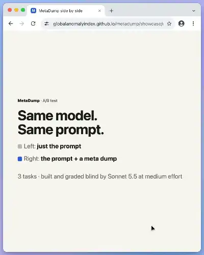

# MetaDump - an agent skill for Claude Code, Codex, and more
Make your agent eat a bunch of info and then... take a dump.

## What's a meta dump?

A meta dump is what I call one big JSON file that's basically a giant chest of information for the model to use. It's filled with everything about whatever you're making: keywords, tiered keywords, associated words, anti-keywords, natural language descriptions, SEO and search vocabulary, inspiration, colors, patterns, references, sources, measurements, timings, transcripts, anything at all like that. You make it once from a prompt (plus reference photos, files, links or videos if you have them), and then the model, or any other skill, tool or subagent, can go back to it whenever it needs to.

Think of it as an AI's version of a stream of consciousness, a brain dump. It's not a rulebook or a bible, and the model doesn't have to obey it. It's more like "here's some stuff to work with": it brings things up from the depths of the model to the surface, where they can be tinkered and played with. It's a seed. It holds the actual facts written down: exact values, real references, screenshots, measurements, timings, stuff with sources. It also holds everything the model knows or can think of around the task: how people describe it, associated brands and works, patterns, what people need, the different ways to read the request, and the decisions coming up with the options for each. It gives the model way more to work with and riff on, and it never shrinks what I asked for. My prompt and the model's own judgment still make the calls.

Making the dump is honestly half the point too, because it forces everything into structure and specifics. And it works the same for anything: a dump about TDD should help the model make actual TDD decisions, the same way a design dump helps with visual ones.

Here's what I used to do by hand, which this automates. Before even prompting, I'd ask my agent to turn a style, like Apple's UI, into a meta dump. I'd give it images and screenshots and have it pull out all of it:
- descriptors, and brand-agnostic ways of describing the look and feel
- actual sources and inspiration
- numbers and the patterns it noticed
- UI and UX principles
- things to do and not do
- tiered keywords, anti-keywords and natural language descriptions

I'm not asking it to recreate a site. I'm asking it to take everything I give it and distill it into one soup of patterns, descriptions and data that lets another agent understand, recreate and imagine what I'm going for without copying anything. A meta dump never copies. It throws a bunch of things in the pot, stirs, and out comes the dump.

## Where the idea came from

People keep saying "AI is a glorified search engine." So I turned it on its head and asked myself, "What if we actually treated AI like a search engine?" Search engines work because everything is indexed with structured metadata, so give the model that.

I also believe that at its simplest, AI is a prediction engine: it takes an input and predicts an output. A short prompt is a tiny input, so the model fills every gap with the most typical guess it can make. A meta dump makes the input way bigger and way more specific, so the prediction gets better.

Before this, I was making meta dumps by asking an agent to make one from a text prompt (and sometimes photos). This skill does that, but better, and it isn't only for design. It works for actual development too: coding, TDD, engineering, writing, whatever you're doing.

## Does it actually help?

I A/B tested it: the same task built with and without a dump, then graded blind. For the latest round I gave 0.12.0 three tasks I never tuned it on, one of each kind: an imaginative one ("a recipe for mammoth steak"), a technical one ("a basic tic tac toe game") and a visual one ("a 3D model of a lemon"). Sonnet 5.5 at medium effort built and graded everything (the dumps themselves are built by a swarm of Haiku agents), with fresh dumps, fresh builds on both sides and blind grading:

| Task | Prompt only | Prompt + meta dump | Dump wins head to head |
|---|---|---|---|
| a recipe for mammoth steak | 4.92 | **7.00** | **96%** |
| a basic tic tac toe game | 6.50 | **7.67** | 71% |
| a 3D model of a lemon | 5.00 | **6.67** | 73% |

The dump side won all three and 54 of 72 head-to-heads (p = 0.02). The recipe was the clearest: the prompt-only recipes were a normal bison steak with a one-line "mammoths are extinct" note, and the dump recipes actually knew things about mammoths (the Yuka carcass, the lab-grown mammoth meatball, which meats are the honest stand-ins), and won 22 of 24. The prompt-only tic tac toe games were basically the same page four times, and the two best games in the whole test came from the dump side. The lemon is the honest one: the dump side was more consistent and won 17 of 24, but the single best lemon was a prompt-only one. Variety went the wrong way on two of the three, too: three of the four dump recipes were the same bone-in bison steak, and the dump lemons all landed on the same layout. So there's still work to do on getting four sessions to go four different ways.

It's still small (4 runs per side per task), so read it as a direction and not proof. Everything for this round is in [`ab-tests/2026-11-05-recipe-game-lemon-sonnet/`](ab-tests/2026-11-05-recipe-game-lemon-sonnet/): the prompts, the dumps, every build, the screenshots, the grades and the scripts.

### See it side by side

Live builds from this round, left without a dump and right with one. The preview is a short video of run 1 of each side, filmed in a browser (no sound). Click it to open the page, where the full video plays and you can try all eight builds per task.

[](https://globalanomalyindex.github.io/metadump/showcase/round-2/)

**[Live page](https://globalanomalyindex.github.io/metadump/showcase/round-2/)** · [video (MP4)](https://globalanomalyindex.github.io/metadump/showcase/round-2/metadump-ab-round-2.mp4) · 54 of 72 head-to-heads

## What makes it work

- **It figures out the task first, then goes from abstract to specific.** If I ask for a shopping component, it starts with the fields that task belongs to (UX, UI design, interaction design, e-commerce, accessibility, front-end) and works down through shopping interfaces and product cards and carts to my component and finally the actual numbers. The top of that ladder gets a primer: what someone who really knows the field would bring, like named principles, laws, standards, common mistakes, and dos and don'ts. That's why it can replace skills with hard-set UI and UX rules: the principles that apply get written down fresh for every task.
- **It covers the whole job.** It writes down everything the person using the result actually does, end to end (for shopping: find, compare, choose, add, review the bag, check out), and the default way of reading the request has to cover all of it.
- **It distills, it doesn't copy.** If I say "Apple's UI" or hand it screenshots, it turns them into brand-agnostic numbers, descriptions, patterns and principles. Brand names stay in the sources, not in the stuff another agent reuses.
- **Every entry says where it came from.** The ranking is `user_stated` > `reference_observed` > `researched` > `inferred` > `proposed`, plus `unknown`. That way the model can tell what I actually asked for from what it made up, and it reaches for the real stuff first. A build script enforces it: a subagent can't claim it researched something it didn't, anything marked `user_stated` has to quote my actual prompt, and anything found online can never pass as my reference.
- **Tiers mean relevance, not rules.** Tier 1 is what the task is most about (12 max), 2 is supporting, 3 is context, and 4 is exploratory ideas to pull from. Only things that were actually collected (my words, my references, things it researched) can be tier 1. The builder's own takes top out at tier 2, so they can't redefine what I asked for.
- **Readings and decisions, not answers.** If a request can mean a few things ("shopping component" could be a product card, a mini cart or a product list), it keeps all of them with a default. The choices coming up (which test to write first, how dense to go) get written down with their options and tradeoffs instead of being decided for you. Same for the quality words in the prompt: "sticky" gets every reading it could have, side by side, and the dump never hands over the finished thing itself (a default set of curves, a palette), because a small model will paste it. Numbers come as dials with a range, never single values, because single values get copied.
- **It pushes your adjectives further.** It isn't allowed to tame them. When I literally asked for an ethereal button, an older version called glow and glass "worn paths" and steered away from them. Now it has to push them further.
- **Anti-keywords.** The opposite of a keyword: something that tells the model "this is not what I mean" (like "acrylic" meaning clear plastic here, not acrylic paint), or just stuff we don't want. Every one comes with an `instead`. A lot of image models (FLUX.2, gpt-image, Gemini) don't have negative prompts, so the only way to say no is to say what to do instead.
- **It indexes itself.** A routing table at the top maps each job ("write the image prompt", "pick the next test", "build the landing page") to the exact JSON paths it needs, with token costs. There's a word index like a real search engine has, and every entry sits on one line so grep works. The model never loads the whole thing, because loading a 100K-token file all at once actually makes the output worse. It only pulls the slice for the step it's on.
- **It reads like the ones I made by hand.** Every entry is a facet: one area of the task with a line of description, lists of short keywords, how it behaves ("thicker transparent material looks darker") and the principle behind it. The dump opens with one central idea, a one-line summary and a formula that says what each part does, then keyword lists from every angle (technical, feel, emotional, cultural, search), influences and what each brings, signals to recognize it, and a description of each reference. It keeps the tiers, sources and `instead` rewrites, because my hand-made files drifted without them.
- **No template.** The sections get designed for whatever you're making. A REST API dump doesn't get a color palette, and a packaging dump doesn't get an error model.
- **Checks that keep it honest.** Dry runs look for numbers that fight with what I asked for and for anything that narrows the request, then a widening round fixes those. Every build prints how much of the dump was actually collected and from how many websites. It warns when the dump is mostly its own guesses, when its sources come from only one or two sites, or when nobody looked at an image it collected.
- **Ticket-driven.** It charts a map of what the dump needs to answer, then hands out tickets to subagents: research, finding videos and images, scraping pages, watching videos, moodboards, specialists, anti-keywords, cleanup, synthesis and dry runs. It runs through the Workflow tool (works with ultracode) or regular subagents, and every subagent runs on Haiku. Before the dump gets written, a digest step breaks everything down into one body, so no page or reference passes through whole. Then a script validates everything, builds the index and writes the final file.
- **A deal, so four sessions don't build the same thing.** Real randomness picks where each session starts and which half of the material it gets, so four sessions reading the same dump don't all go the same way.
- **It looks at what it built.** The last step of using a dump is a script that renders the page headlessly, screenshots it at desktop and phone widths, hovers and clicks it, and lists what's clipped, overlapping or cut off. The model reads the screenshots and fixes it before it finishes.

## Pages, videos and images

When it's making a dump (lol), it can go get the specifics itself, with nothing to install:

- **Research that actually goes wide.** For each thing in my prompt it looks at how people describe it, the principles behind it, brands and products and people known for it (and what's worth borrowing from them, not copying), common patterns and mistakes, what people actually need, real numbers, and the decisions coming up. Lots of sources, not one page.
- **Pages.** Give it a link, or let it find some, and it fetches the page, cleans it into text with the headings kept, chops it into chunks, screenshots it if the look matters, and then interprets it: a few quoted facts plus what the page shows and what transfers to my task. It's not a copy of the page. It checks robots.txt and waits between requests so it isn't rude.
- **Videos.** Give it a video link or file and it grabs the title, length, fps, chapters and caption tracks, and turns the captions into a clean transcript with timecodes. It also pulls frames at whatever times you want and can measure animation timing: how long each move takes, where it holds, whether it's animated on twos, and roughly what easing it uses.
- **Images.** It collects my reference photos plus images from pages, page screenshots and video frames, samples the actual colors, and makes a moodboard page right next to the dump. It skips logos, icons and blank placeholder images, and the model actually looks at every image that's left and writes down what it sees.
- **Finding things on its own.** If I don't give it references, or mine don't cover something (like how a thing moves or how long an animation takes), it goes looking for videos, images and pages that would show it, then watches, scrapes and collects the best few. There's a cap so it doesn't go overboard: lite grabs 1 video, 3 pages and 8 images; standard 3, 6 and 16; deep 5, 10 and 32. It tells you what it skipped because of the cap, and anything it found itself is marked as found online. If you only want it to use your stuff, just say so.

It all runs on plain Python plus the Chrome (or Chromium, Edge or Brave) you already have, driven headless. If you happen to have yt-dlp or ffmpeg it'll use them, but you don't need them. `python3 skills/metadump/scripts/tools.py` shows what it found.

It won't get around logins, age gates, paywalls or anything like that, and downloading from places like YouTube can be against their terms, so it sticks to metadata, captions and sampled frames. Heads up: right now YouTube won't give captions or play past the first few seconds for a headless browser, so for YouTube it tells you that, and you can install yt-dlp or hand it a caption file. Local video files work fine. When it's finding videos on its own, it goes for ones it can actually read (direct video files, like the originals on Wikimedia Commons, or the maker's own site) over YouTube.

## Install

```bash
claude plugin marketplace add globalanomalyindex/metadump
claude plugin install metadump@metadump
```

or just give your agent the GitHub link and tell it to install it for you!

## Stay up to date

Updates don't install themselves by default. Claude Code only auto-updates Anthropic's official plugin marketplaces, and every other marketplace (this one included) starts with auto-update off. So pick one of these:

- **Turn on auto-update once.** In Claude Code, run `/plugin`, open the **Marketplaces** tab, pick **metadump**, and choose **Enable auto-update**. From then on, new versions download in the background when a session starts, and your next session uses them.
- **Or update by hand whenever you want:**

  ```bash
  claude plugin update metadump@metadump
  ```

Or just ask your agent to update it for you. `claude plugin list` shows which version you have. The newest is whatever `version` says in [`.claude-plugin/plugin.json`](.claude-plugin/plugin.json).

## Use

/metadump:metadump in your agent, or just ask for one: "make a metadump for ...", and attach photos or files or paste links to pages or videos if you have them. Say "lite" if you want it fast or "deep" if you want everything.

It saves to `metadumps/<slug>.metadump.json` in your project. Scratch work goes in `metadumps/.work/`, and you can delete that whenever.

Once a dump exists, you don't have to do anything. Any skill working in that project writes down its own take first, then reads the top of the dump, pulls the slice for the step it's on, uses what helps, and writes new decisions back into it.

## Example

[`examples/metadumps/luminous-translucency.metadump.json`](examples/metadumps/luminous-translucency.metadump.json) is an early lite run on my luminous chromatic translucency prompt: 217 entries, 43 anti-keywords, 16 researched facts with real links, a ready-to-paste image prompt, and open questions with defaults for the things the prompt didn't decide. The newer dumps from the A/B tests are in `ab-tests/*/metadumps/`.

## What's in here

```
.claude-plugin/              plugin + marketplace manifest
skills/metadump/
  SKILL.md                   how the skill works (create mode + use mode)
  references/                the full procedure, worker briefs, format, mechanisms, export rules
  scripts/finalize.py        builds and checks the dump (Python 3.9+, no installs)
  scripts/index.workflow.js  the subagent fan-out for the Workflow tool
  scripts/webpages.py        fetches, cleans and screenshots pages
  scripts/video.py           video info, captions, frames and timing
  scripts/images.py          collects images, samples colors, makes the moodboard
  scripts/tools.py           shows which optional tools you have
  scripts/cdp.py, pixels.py  the headless Chrome driver and PNG decoder (plain Python)
  evals/                     test prompts
tests/                       tests for all of it (one of them drives your Chrome if you have it)
ab-tests/                    the A/B tests: prompts, dumps, builds, screenshots, grades, scripts
examples/metadumps/          dumps made with this
GLOSSARY.md, docs/adr/       the words and decisions behind it
docs/clean-room/             how the page scraper got written without copying anyone
```

## Dev

```bash
python3 -m unittest discover -s tests
node --test tests/workflow.test.mjs
claude plugin validate .
METADUMP_LIVE=1 python3 -m unittest discover -s tests   # also hits the real internet
```

## License

MIT
